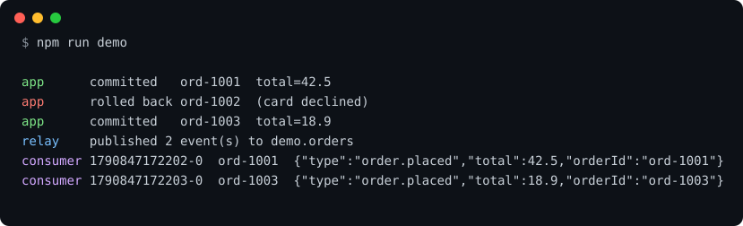

# outboxd

Transactional outbox relay for PostgreSQL and Redis Streams.

Writing a row and publishing an event are two different systems, and one of
them will fail at the wrong moment. `outboxd` removes the second write from the
request path: the event is inserted into an `outbox` table inside the same
transaction as your data, and a relay moves committed rows to Redis Streams.
If the transaction rolls back, the event never existed. If Redis is down, the
event waits.



Three orders are placed, the second one is rolled back, and only the two
committed ones reach the stream.

## Guarantees

- **Atomic with your data.** An event is visible to the relay only once the
  transaction that wrote it commits.
- **At least once.** A batch is marked published in the same transaction that
  claims it. If publishing fails halfway, the whole batch stays pending and is
  sent again, so consumers must be idempotent. Every stream entry carries the
  outbox `id` for that purpose.
- **Ordered.** Rows are published in `id` order by a single active relay.
  Extra relay processes are safe: they compete for one advisory lock and act
  as hot standbys.
- **Low latency without busy polling.** An insert trigger issues `NOTIFY`, so
  the relay wakes up immediately. Polling remains as a fallback.

Not provided: exactly-once delivery, and ordering between transactions that
commit out of `id` order. If two writers race on the same key, serialise them
in your application.

## Usage

```sh
npm install outboxd
DATABASE_URL=postgres://... npx outboxd migrate
```

Enqueue with the same client that runs your transaction:

```js
import { enqueue } from 'outboxd';

await tx.query('BEGIN');
await tx.query('INSERT INTO orders (id, total) VALUES ($1, $2)', [id, total]);
await enqueue(tx, { topic: 'orders', key: id, payload: { type: 'order.placed', id, total } });
await tx.query('COMMIT');
```

Run the relay next to your application:

```sh
DATABASE_URL=postgres://... REDIS_URL=redis://... npx outboxd run
```

Each event becomes one entry in the stream named after its topic, with the
fields `id`, `key` and `payload` (JSON).

| Command   | What it does                                                    |
| --------- | --------------------------------------------------------------- |
| `migrate` | Creates the `outbox` table and its wake-up trigger. Idempotent. |
| `run`     | Relays pending events until `SIGINT` or `SIGTERM`.              |
| `prune`   | Deletes events published before the retention window.           |

| Variable                 | Default                  |
| ------------------------ | ------------------------ |
| `DATABASE_URL`           | required                 |
| `REDIS_URL`              | `redis://localhost:6379` |
| `OUTBOX_BATCH_SIZE`      | `100`                    |
| `OUTBOX_POLL_MS`         | `1000`                   |
| `OUTBOX_RETENTION_HOURS` | `168`                    |

The relay can also be embedded: `new Relay({ pool, redis, logger }).run(signal)`.

## Development

```sh
docker compose up -d
docker compose exec postgres createdb -U postgres outbox_test
npm install
npm run lint
npm test
npm run demo
```

The suite runs against real PostgreSQL and Redis: unit tests for configuration
and backoff, integration tests for the relay (rollback, ordering, retry after
a failed publish, competing relays), and end-to-end tests that drive the CLI
as a child process.

## License

MIT
